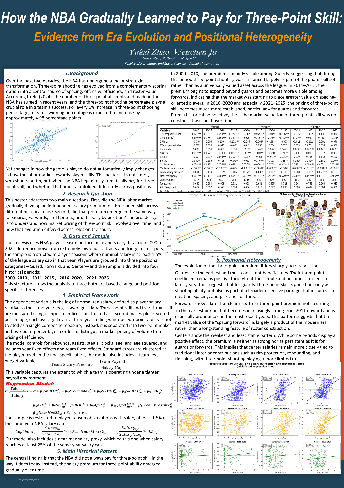
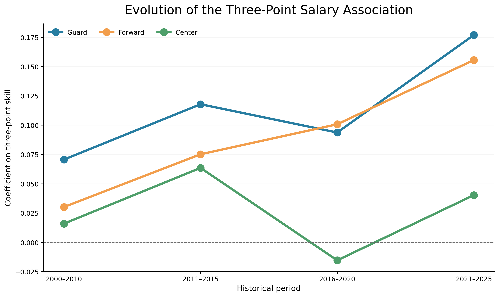
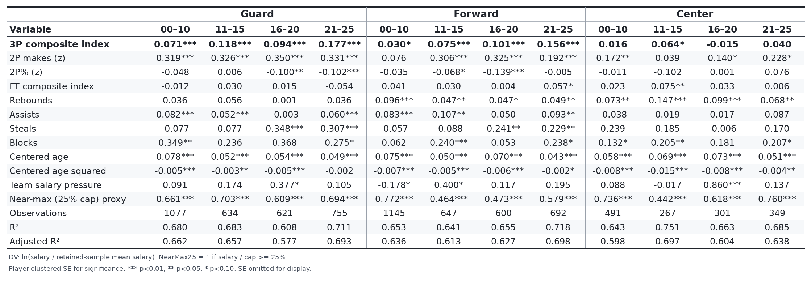

# How the NBA Gradually Learned to Pay for Three-Point Skill
### Evidence from Era Evolution and Positional Heterogeneity (2000–2025)

**Yukai Zhao · Wenchen Ju**  
School of Economics, University of Nottingham Ningbo China

[](#quick-start) [](#empirical-strategy) [](#reproduction-status)

> **Research question.** Has the relationship between three-point shooting ability and NBA player salary changed over time, and does it differ among guards, forwards and centers?

This is a reproducible Python implementation of the **near-max-proxy specification** presented in our research poster. It estimates player-season salary regressions for **three position groups** across **four historical periods**. The project separates the original poster specification from subsequent postseason-control explorations and documents important data and identification limitations.

## Research poster

The original one-page poster is shown below. Select the image or [open the full-resolution PDF](assets/research_poster.pdf) for closer inspection.

<a href="assets/research_poster.pdf"></a>


## Reproduced coefficient figure



*Figure: Coefficient on a composite three-point skill index, controlling for observed player production, age, team-year payroll proxy, near-max salary proxy, team and year fixed effects. The lines are descriptive sequences of four separately estimated coefficients—not a continuous trend or a causal estimate.*

## Main findings

Under the replicated poster specification:

- **Guards** have a positive coefficient in all four periods, from **0.071** in 2000–2010 to **0.177** in 2021–2025.
- **Forwards** have a smaller early coefficient (**0.030**, p ≈ 0.082) but larger positive coefficients in later periods, reaching **0.156** in 2021–2025.
- **Centers** have smaller, less stable coefficients; their estimates are not consistently significant at the 5% level.

These are **conditional associations**, not a causal measure of how much the NBA pays for an additional unit of shooting skill. The increase between period-specific estimates is not, by itself, a formal statistical test of coefficient differences. The composite skill index uses within-year standardized makes and accuracy; one unit of the index is **not necessarily one standard deviation of the combined index**.

### Core three-point coefficient estimates

| Position | 2000–2010 | 2011–2015 | 2016–2020 | 2021–2025 |
|---|---:|---:|---:|---:|
| Guard | 0.0706*** | 0.1178*** | 0.0937*** | 0.1769*** |
| Forward | 0.0301* | 0.0751*** | 0.1007*** | 0.1556*** |
| Center | 0.0159 | 0.0635* | −0.0154 | 0.0403 |

`*** p < 0.01`; `** p < 0.05`; `* p < 0.10`. Significance is based on **player-clustered standard errors**. The complete set of coefficients and standard errors can be generated using the instructions below.



## Empirical strategy

For player *i*, observed on team *j* in season-ending year *t*, each position × era group is estimated separately:

```math
\begin{aligned}
\ln(\mathrm{Salary}_{ijt}/\overline{\mathrm{Salary}}_{t,\mathrm{retained}})
&= \alpha + \beta_1 \mathrm{Skill3P}^{(3)}_{it}
+ \beta_2 Z(2PMade)^{(3)}_{it}
+ \beta_3 Z(2P\%)^{(3)}_{it}\\
&\quad+ \beta_4 \mathrm{SkillFT}^{(3)}_{it}
+ \beta_5 \mathrm{TRB}^{(3)}_{it}
+ \beta_6 \mathrm{AST}^{(3)}_{it}
+ \beta_7 \mathrm{STL}^{(3)}_{it}
+ \beta_8 \mathrm{BLK}^{(3)}_{it}\\
&\quad+ \beta_9 \mathrm{AgeC}^{(3)}_{it}
+ \beta_{10}(\mathrm{AgeC}^{(3)}_{it})^2
+ \beta_{11} \mathrm{TeamPressure}^{(3)}_{it}\\
&\quad+ \beta_{12} \mathrm{NearMax25}_{it}
+ \delta_t + \gamma_j + \varepsilon_{ijt}.
\end{aligned}
```

**Definitions and implementation:**

- **Outcome:** `ln(Salary / AvgSalary)`, where `AvgSalary` is the same-year mean salary **among records passing the 1.5%-of-cap filter** in the historical implementation. It is **not necessarily the full-league mean**. With year fixed effects, changing to another positive within-year scaling shifts year-specific intercepts, but not the slopes in the same regression sample.
- **Sample:** `Salary / SalaryCap ≥ 0.015`.
- **Three-point skill:** `Skill3P = Z_by_year(3P makes) + Z_by_year(3P%)`; free-throw skill is formed analogously. Two-point makes and 2P% enter separately.
- **Smoothing:** The historical script applies `rolling(3, min_periods=1)` **after filtering**, by player name. This is a rolling mean of up to three available retained player records, **not guaranteed to cover three consecutive calendar years**.
- **Team salary pressure:** retained-sample team salary sum / same-season cap, then rolled over each **player's** successive observed seasons. This is **not a verified all-contract team payroll**. The formula's rolling term therefore has a player-season index (not only a team-year index).
- **Near-max proxy:** `NearMax25 = 1` if current `Salary / SalaryCap ≥ 0.25`; `0` otherwise. This is not legal identification of a max contract. As it is itself computed from salary, the higher R² after adding it **must not be interpreted as evidence that salary-cap censoring is corrected**.
- **Other controls:** rebounds, assists, steals, blocks, centred age and its squared term. Minutes played are excluded.
- **Fixed effects:** calendar-season-ending-year and franchise-team identifier; **standard errors clustered by `Player` string**.

**Four historical periods:** 2000–2010, 2011–2015, 2016–2020, 2021–2025. `Year` denotes the season-ending calendar year.

For all variable definitions, see [Data Dictionary](docs/DATA_DICTIONARY.md). For a full methodological review, see [Methodology and Limitations](docs/METHODOLOGY_AND_LIMITATIONS.md). For the research-development history, see [Research Development Record](docs/RESEARCH_HISTORY.md).

### Sample and additional controls

The sample restriction, the upper-tail proxy, and the team-payroll proxy can be written as:

```math
\mathrm{CapShare}_{it} = \frac{\mathrm{Salary}_{it}}{\mathrm{SalaryCap}_t} \geq 0.015
```

```math
\mathrm{NearMax25}_{it} =
\begin{cases}
1, & \mathrm{Salary}_{it}/\mathrm{SalaryCap}_t \geq 0.25,\\
0, & \text{otherwise}.
\end{cases}
```

```math
\mathrm{TeamPressure}_{jt} =
\frac{\mathrm{ObservedTeamPayroll}_{jt}}{\mathrm{SalaryCap}_{t}}
```

Here, *ObservedTeamPayroll* means the sum over **retained records**, not verified total franchise payroll. The historical regression uses a player-history rolling average of this ratio, as noted above.

## Quick start

```bash
git clone https://github.com/YOUR_USERNAME/nba-three-point-salary-pricing.git
cd nba-three-point-salary-pricing
python -m venv .venv
# activate your virtual environment, then:
pip install -e '.[dev]'
```

The player-level source CSV **is included in this repository** at:

```text
data/raw/NBA Player Stats and Salaries_2000-2025.csv
```

No separate data upload is needed. You can immediately run the input audit and the 12 poster regressions using the commands below. **Important:** The file was supplied by the project authors for this package, but the dataset's ultimate compilation provenance and redistribution rights have not been verified. Inclusion does **not** imply that the underlying third-party material is licensed for public distribution. Confirm permission before setting the repository to public. The code does not scrape Basketball-Reference or other sites automatically.

Run the input audit:

```bash
nba-pricing audit \
  --input 'data/raw/NBA Player Stats and Salaries_2000-2025.csv' \
  --out outputs/audit
```

Re-estimate the full set of **12 poster regressions** and generate figures:

```bash
nba-pricing run \
  --input 'data/raw/NBA Player Stats and Salaries_2000-2025.csv' \
  --out outputs/poster \
  --compare data/reference/poster_nearmax_coefficients.csv
```

Windows PowerShell: place the full command on **one line** instead of using `\` for continuation. For environments where the command has not been installed, use `python -m nba_pricing.cli` in place of `nba-pricing` after installation.

Outputs include:

| File | Description |
|---|---|
| `outputs/poster/coefficients_full.csv` | All fitted terms, including team/year fixed-effect indicators, estimates, player-clustered SEs, p-values |
| `outputs/poster/model_summary.csv` | 12 subgroup sample sizes, distinct players, R² and 3P coefficients |
| `outputs/poster/era_storyline.png` | Three-position coefficient storyline (no confidence bars) |
| `outputs/poster/regression_table.png` | Compact poster table; coefficient and stars, without SE lines |
| `outputs/poster/partial_residual_12_panels.png` | 12 **controlled** partial-regression residual panels |
| `outputs/poster/partial_residuals_combined.png` | Pooled visual display of separately residualised points (no pooled slope) |
| `outputs/poster/reference_comparison.csv` | Row-by-row check against archived near-max coefficients |

*Note:* The partial-residual figures include **NearMax25** and **TeamPressure** in the controls. Raw bivariate fitted lines from earlier drafts are intentionally not treated as controlled regression coefficients.

## Reproduction status

We re-ran the exact poster-model processing sequence using the uploaded CSV with **10,473 player-team-season rows**. The 12 subgroup coefficients matched the archived near-max results with a **maximum absolute numerical difference of approximately 9.7 × 10⁻¹⁷** across the archived key terms. This reproduces the **historical computation**, not the correctness of every input, cap number, causal interpretation or sampling decision.

The dataset includes only **153 rows for season-ending 2000**, **177 in 2004**, and **117 in 2005**, compared with over 400 in many later years. It also contains four player-year pairs with multiple team rows. These are documented in the input audit and can materially affect comparisons, payroll totals, and player rolling means.

## Experimental extension: past postseason outcomes

The team-level extension adds **previous-season team playoff tier**, with categories `0` (no playoffs), `1` (playoffs before conference finals), `2` (conference finals), `3` (NBA finalist), and `4` (champion). It **requires an independently validated, complete (season-ending year, team abbreviation, tier) CSV**. Missing observations are **never coded as zero**. See `data/external/playoff_tiers_template.csv` and [Postseason Extension](docs/POSTSEASON_EXTENSION.md).

```bash
nba-pricing run \
  --input 'data/raw/NBA Player Stats and Salaries_2000-2025.csv' \
  --playoffs data/external/playoff_tiers_verified.csv \
  --out outputs/playoff_extension
```

This extension is **not** part of the replicated poster main results and is not claimed reproducible without a validated postseason dataset. Moreover, a team's past playoff result is not the same as an individual player's past playoff contribution.

## Repository layout

```text
.
├── README.md
├── README_zh.md
├── pyproject.toml
├── requirements.txt
├── src/nba_pricing/
│   ├── constants.py         # historical salary-cap lookup and eras
│   ├── preprocessing.py     # source checks, composite skills, rolling statistics
│   ├── regression.py        # 12 clustered-SE OLS regressions
│   ├── figures.py           # coefficient chart and FWL scatter plots
│   ├── tables.py            # compact poster regression table
│   ├── audit.py             # coverage and duplicate checks
│   └── cli.py               # command-line entry point
├── tests/                   # tests for transformations and modelling
├── docs/                    # data dictionary, methods, caveats, postseason extension
├── data/raw/                # bundled player-season source CSV (check redistribution rights)
├── data/reference/          # archived numerical results from earlier poster model
├── data/external/           # playoff-tier template only (no invented data)
└── assets/                  # reproducible static demonstration charts
```

## Research interpretation and limitations

**We do not identify a causal effect of shooting on wages.** Salary reflects long-term contract decisions, player reputation, unobserved ability and team context. The model includes contemporaneous regular-season production while salary is often determined under an earlier contract. Importantly, the current `NearMax25` dummy is derived from observed salary, and `TeamPressure` sums salaries including the dependent observation; both present a risk of mechanical correlation/endogeneity.

Historical cap numbers, the 1.5%-of-cap inclusion rule, mixed-position classification, within-year standardisation after filtering, incomplete early-year coverage, and the name-keyed rolling calculations should be treated as **explicit historical research choices**, not universally defensible defaults. Statistical significance alone does not prove an economic mechanism. See [Methodology and Limitations](docs/METHODOLOGY_AND_LIMITATIONS.md).

## Sources and provenance

- Original research poster: *How the NBA Gradually Learned to Pay for Three-Point Skill*, Yukai Zhao and Wenchen Ju, University of Nottingham Ningbo China (2026); source file supplied by the authors. The poster's earlier draft uses an external "Hu (2024)" statistic, whose **full bibliographic reference requires verification before publication**.
- Raw player-performance and salary CSV: **user-provided combined dataset bundled in `data/raw/`**, ultimate compilation methodology and external usage rights **not established** in this repository.
- NBA salary-cap announcements: [NBA Communications salary-cap archive](https://pr.nba.com/tag/salary-cap/) and [2024–25 official cap announcement](https://pr.nba.com/2024-25-nba-season-salary-cap/).
- Max-salary legal background: [NBA CBA 2023 transcription, Article II §7](https://atlhawksfanatic.github.io/NBA-CBA-2023/uniform-player-contract.html). The 25% indicator is a **proxy**, not contract-level legal coding.

Please verify rights before publicly posting third-party datasets, NBA trademarks, player photographs or copyrighted poster templates.

## Award Certification


Short description and suggested repository topics are in [GITHUB_ABOUT.md](GITHUB_ABOUT.md).

## License

Original project code and documentation are under the [MIT License](LICENSE); underlying third-party statistics, photos, trademarks and templates are **not** covered by this license.
